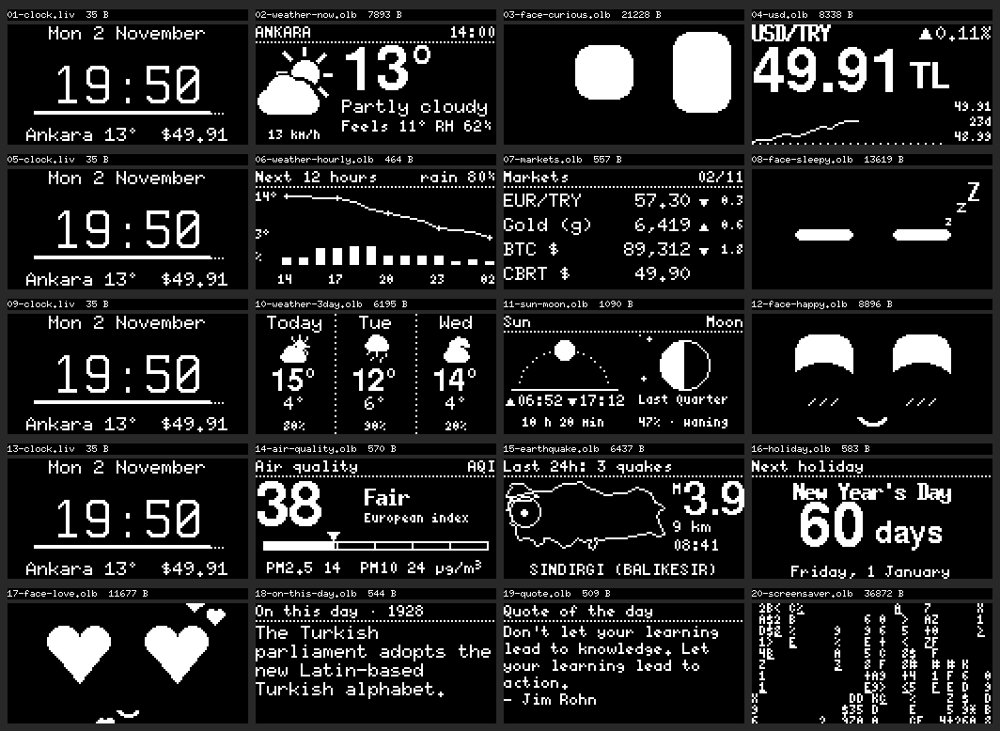

# ESP_Buddy

ESP_Buddy is a small desk companion built from an ESP32 and a 0.96" 128×64 monochrome OLED. It cycles through these screens:

- a live clock
- the weather
- USD/TRY and other markets
- the latest earthquake
- the next public holiday
- "on this day"
- a quote of the day

Between them a **face** shows up, and its mood follows the day's data. Every screen exists in **English and Turkish**; you choose the language on the web page when you send them.

The device never goes online. Your phone fetches the data and passes it to the device over **Bluetooth Low Energy**.



```
GitHub Actions (every 3 h)                 GitHub Pages                   iPhone (Bluefy)           ESP32 + OLED
APIs -> Python -> 1-bit screens      ->    preview + manifest       ->   "Connect & send"  --BLE-->  saves to flash,
           (.olb / .liv, EN + TR)          EN / TR switch                syncs the time             plays them in order
```

Setup steps: **[SETUP.md](SETUP.md)**.

## Screens

| Screen | Source | Notes |
|---|---|---|
| Live clock | phone time | Drawn by the device. Synced when you connect, then keeps running until power is lost |
| Weather now | Open-Meteo | Animated icon: rotating sun rays, falling rain and snow, lightning, moon and stars at night |
| Next 12 hours | Open-Meteo | Temperature curve and chance-of-rain bars |
| 3-day forecast | Open-Meteo | Icon, high/low, chance of rain |
| Sun & Moon | Open-Meteo + calculation | Sunrise/sunset, day length, drawn moon phase |
| Air quality | Open-Meteo AQ | European AQI gauge, PM2.5, PM10 |
| USD/TRY | Yahoo → currency-api → CBRT; chart from Yahoo or Frankfurter (ECB) | Daily change and a ~30-day chart that draws itself |
| Markets | Yahoo / currency-api, Truncgil, CoinGecko, CBRT | EUR/TRY, gold per gram, BTC, official CBRT USD rate |
| Earthquake | Kandilli (community API) | Largest quake of the last 24 h, blinking on a map of Turkey |
| Next holiday | Nager.Date | Days left; confetti on the day itself |
| On this day | Wikipedia (EN or TR) | Long entries are split into pages |
| Quote of the day | ZenQuotes | English in both languages |
| Screensaver | — | Game of Life / starfield / Matrix, a different one each day |
| Face | — | See below |

You set the screen order, which screens are on, the city and the display time in **[screens.md](screens.md)**. Edit it on GitHub and commit; Actions regenerates the screens by itself.

### The face's mood

Each `face` line in `screens.md` gets one mood. Moods are picked from the day's data, and any slots left over get surprise moods.

| When | Mood |
|---|---|
| USD/TRY up more than 1% in a day, or a big earthquake | Shocked (huge eyes, sweat drop) |
| USD/TRY down more than 0.7% | Happy |
| Rain today | Sad (a tear, plus rain) |
| Snow, or ≤ 2 °C | Freezing (shivering, snowflakes) |
| Sunny and ≥ 18 °C | Cool (sunglasses) |
| Polluted air (AQI > 60) | Angry |
| A public holiday within 7 days | Excited (star eyes) |
| Friday | Party (confetti) |
| Monday | Sleepy (zzz) |
| Weekend | In love (heart eyes) |
| Always | Curious (looks around, blinks) |
| Surprise | Laughing, dizzy (spiral eyes), winking… |

The web page shows why each mood was picked under "Today's faces".

## Folders

```
firmware/ESP_Buddy/   ESP32 sketch (Arduino IDE)
generator/            Python: data fetching, drawing, .olb generation (generate.py)
  fonts/              pixel fonts with Turkish letters (BDF)
  sample_data/        saved API responses for offline testing
site/                 GitHub Pages site (preview + BLE sender + remote, EN/TR)
tools/                font preparation script
screens.md            screen order and settings
PROTOCOL.md           BLE commands and file formats
```

## Trying it on a computer

```bash
pip install -r generator/requirements.txt
python generator/generate.py --sample      # offline, sample data (omit --sample for the real APIs)
python -m http.server 8000 -d _site        # open http://localhost:8000
```

Chrome and Edge also allow Web Bluetooth on `localhost`. If your computer has Bluetooth, you can send to the device from there.
